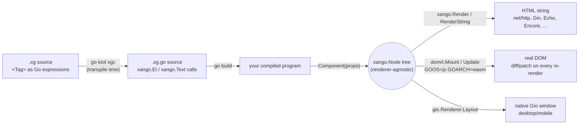

# Xangô

[](https://github.com/elaous/xango/actions/workflows/pr.yml)
[](https://github.com/elaous/xango/actions/workflows/nightly.yml)

A JSX-style renderer written in Go: write markup in Go source and render it on the server or in the browser via WASM.

```go
func Greeting(props GreetingProps) xango.Node {
	if props.Name == "" {
		return <p class="greeting">Hello, stranger!</p>
	}
	return <p class="greeting">Hello, {props.Name}!</p>
}
```

Write `<div>...</div>` tags directly in Go source, anywhere a Go expression is legal. They compile down to plain Go that
renders identically on the server (HTML strings) and in the browser (real DOM, via WASM), with no separate template
language. Xangô was extracted from Gojiberry ([github.com/elaous/gojiberry](https://github.com/elaous/gojiberry)), which now uses it.

## Status and compatibility

Xangô is at **v0**. Between minor versions (`v0.1.x` to `v0.2.x`) the API, the `.xg` syntax and the generated code MAY
change in ways that break callers. Pin an exact version, and regenerate every `.xg.go` file with the matching `xgc` when
you bump it. Patch releases SHOULD stay compatible. The compiler lives in `internal/transpile` and has no public Go API.

Packages in this module:

| Import path | What |
| --- | --- |
| `github.com/elaous/xango` | the runtime: `Node`, `Render`, `Document` |
| `github.com/elaous/xango/domrt` and `domrt/...` | the browser renderer (`GOOS=js GOARCH=wasm`) |
| `github.com/elaous/xango/cmd/xgc` | the compiler command |
| `github.com/elaous/xango/gio` | the Gio renderer; its own Go module (`gio/go.mod`) |

## The name

Xangô (shan-GOH) is the Yoruba orisha of thunder, lightning and justice
(Sàngó in Yoruba; Xangô in Brazil, where Candomblé keeps his worship alive).
The engine takes his name for the lightning: markup goes in, plain Go comes out
in a flash, and the result is fair to every renderer, the same tree for
server, browser and window. In code the name is ASCII: the package is `xango`,
templates are `.xg` files and the generated Go is `.xg.go`. (Xangô was called Gox before.)

## How it works

Two separate steps, run at two separate times:

1. **Transpile time** (`go tool xgc <dir>`, or `go generate ./...` with a
   `//go:generate go tool xgc .` directive in your project): every `*.xg` file's
   `<Tag>` expressions are rewritten into plain `xango.El`/`xango.Text`
   calls, emitted as an ordinary `*.xg.go` file next to it. This file
   is committed like `templ`'s own `*_templ.go` convention, so
   `go build`/`go test` never need `xgc` on the critical path.
2. **Run time**: your component function runs as plain compiled Go —
   there's no interpreter, template engine, or reflection involved —
   and returns a `xango.Node`, a plain tree (element / text / fragment /
   raw) that carries no opinion about how it gets displayed. The same
   tree feeds whichever renderer(s) your program calls:



The `xango.Node` tree itself never knows which of these it's headed for
— `xango.Render`/`domrt.Mount`/a `gio.Renderer` are just three
different functions that each walk the exact same tree shape and do
something different with it (see `render.go`, `domrt/domrt.go`, and
`gio/render.go`, in that order, if you want to read the actual walk
each one does — `gio` is its own separate Go module, like some of the
examples are, so it can depend on `gioui.org` without adding it
to this one; see `gio/README.md`). Nothing about writing a component
needs to know or care which renderer(s) will eventually consume it.

## Getting Started

Requires Go 1.26+. Add the runtime and the compiler to your project:

```
go get github.com/elaous/xango@v0.1.0
go get -tool github.com/elaous/xango/cmd/xgc@v0.1.0
```

The second command records `tool github.com/elaous/xango/cmd/xgc` in your `go.mod`, so `go tool xgc` builds the
compiler at the version your module selects.

Write a component (`hello.xg`):

```go
package main

import (
	"fmt"

	"github.com/elaous/xango"
)

func Greeting(name string) xango.Node {
	if name == "" {
		return <p class="greeting">Hello, stranger!</p>
	}
	return <p class="greeting">Hello, {name}!</p>
}

func main() {
	html, err := xango.RenderString(Greeting("xango"))
	if err != nil {
		panic(err)
	}
	fmt.Println(html)
}
```

Transpile it, pointing `xgc` at your project's directory:

```
go tool xgc .
```

Then run it:

```
go mod tidy
go run .
# <p class="greeting">Hello, xango!</p>
```

From here:

- `examples/ssr-demo` is the smallest complete example in this repo —
  read it alongside this walkthrough.
- `examples/wasm-counter` shows the same component shape mounted into
  a real browser DOM instead, via `domrt` and `GOOS=js GOARCH=wasm`.
- Every directory under `examples/` has its own `Makefile` (`make run`,
  `make test`) wrapping the exact commands its own section below
  documents — see [Development](#development).
- `## Packages` and `## Components` below are the reference material
  for everything you can import once the basic loop above is familiar.

## Why tags can just be Go expressions

Go's generics use `Foo[T]`, not `Foo<T>`, so unlike TSX there's no
ambiguity between a tag and a generic instantiation to resolve. The
only remaining question is distinguishing a tag-open from the
less-than operator (`a < b`), which `.xg` resolves the same way JSX
parsers do: `<` only means "less than" immediately after something
that completes a value (an identifier, a literal, or a closing
`)`/`]`/`}`). Everywhere else — after `return`, `(`, `,`, `=`, `{`, or
at the start of a statement — a `<` can only legally begin a new
expression, so that's exactly where a tag is allowed to start.

`{expr}` holes, in both attribute values and child position, are
always a single Go expression, exactly like JSX. There's no separate
`if`/`for` template syntax: loops and conditionals are ordinary Go,
usually via an inline closure —

```go
<ul>{func() []xango.Node {
	var items []xango.Node
	for _, s := range list {
		items = append(items, <li>{s}</li>)
	}
	return items
}()}</ul>
```

— which is itself just a Go expression, so tags inside its body are
expanded by the same recursive scan, with no extra grammar required.

## Packages

- **`xango`** — the runtime. `Node` is a plain, renderer-agnostic tree
  (element / text / fragment / raw) that both the server and the
  client render from, so a component behaves identically either way.
  `xango.Render`/`xango.RenderString` render to HTML with automatic
  escaping (`xango.Raw` is the explicit escape hatch). `xango.Event.Value`
  is `any`, read back type-safely via `xango.EventValue[T]`.
- **`internal/transpile`** — the `.xg` → `.go` source-to-source
  transpiler described above, plus the stable resource-import loaders
  (JSON/JSONC/JSONL, CSS) and the `@title`/`@wasm`
  page-metadata annotations, both described below. Beyond tag/brace
  structure (mismatched/unterminated tags, malformed attributes — all
  caught with a real line/col error), a lowercase tag's name and its
  non-event attribute names are validated against a real HTML tag/
  attribute list (`htmlvalidate.go`) — `<dvi>` (a typo for `<div>`) or
  `calss="x"` (for `class`) now error at transpile time instead of
  silently rendering broken markup with no warning anywhere. A tag
  name containing a hyphen (a custom element, e.g. `<my-widget>`) and
  its attributes are always accepted, the same as a Component's own
  props — neither is a fixed HTML vocabulary. `data-*`/`aria-*`
  attributes are always accepted too, per their own specs. If xango
  rejects a real tag/attribute this list is simply missing, add it to
  `validHTMLTags`/`validHTMLAttrs`.
- **`internal/transpile/experimental`** — the resource-import loaders
  that shell out to a mature external tool this project doesn't
  reimplement (HCL/proto/capnp/sqlc), wired in only via
  `transpile.Options.ExperimentalLoaders` — see Resource imports below.
- **`cmd/xgc`** — the CLI: `go run ./cmd/xgc <dir>` (`go tool xgc <dir>` in a project that declares it as a tool) transpiles every
  `*.xg` under `<dir>` into a gofmt-clean `*.xg.go` next to it (the
  generated file is committed, like `templ`'s `*_templ.go` convention,
  so `go build`/`go test` work without running xgc first). Wired up
  as `go generate` by a project's own `//go:generate go tool xgc .` directive. `-experimental`
  (or `XANGO_EXPERIMENTAL=1`) enables the experimental resource imports
  below; a directory literally named `experimental` is otherwise
  skipped entirely.
- **`domrt`** — the client runtime (`GOOS=js GOARCH=wasm` only).
  `domrt.Mount` creates real DOM nodes for a `xango.Node` tree;
  `Root.Update` diffs the next tree against what's live and patches
  only what changed — text content in place, attributes added/removed,
  event listeners registered at most once per (element, event) with
  the Go closure swapped on later renders, and children reconciled by
  key when present — preserving DOM node identity (focus, scroll
  position, input state) wherever the shape didn't change.
- **`domrt/browser`** (`GOOS=js GOARCH=wasm`) — `browser.Global(name)`
  exposes any global browser API by name (e.g. `Global("WebAssembly")`)
  for one-offs; typed wrappers cover the APIs most apps need: `Fetch`/
  `Response.Text`/`Response.JSON`, `LocalStorage`/`SessionStorage`,
  `Connect` (WebSocket), `Document()`/`Window()` (see `domrt/html`),
  `OpenDatabase` (IndexedDB — open/upgrade/transaction/object-store,
  each blocking call bridged from IndexedDB's event-based requests the
  same way `domrt.Await` bridges Promises), `GetUserMedia`/
  `EnumerateDevices`/`SetVideoSource` (camera/mic),
  `WriteClipboardText`/`ReadClipboardText`, the File API (`File`'s
  `ReadAsText`/`ReadAsArrayBuffer`/`ReadAsDataURL`, bridged from
  `FileReader`'s events the same way as IndexedDB, plus
  `CreateObjectURL`/`RevokeObjectURL`) for reading `html.InputElement`'s
  or `html.DataTransfer`'s `File` objects, `FormData`
  (`NewFormData`/`NewFormDataFromForm`, `Append`/`AppendFile`/`Get`/
  `Has`/`Delete`) for multipart submissions — pass its `.Value` as
  `FetchOptions.BodyValue` for a real file upload over `fetch` —,
  `Cookies` (`Get`/`All`/`Set`/`Delete`, values percent-encoded on the
  way in and out so arbitrary strings round-trip), `CurrentPosition`/
  `WatchPosition` (Geolocation), `NewWorker` (a dedicated Web
  Worker running a separate Go/WASM binary on a real background thread
  — see `domrt/worker` for the worker-side half and
  `wasm-worker-demo` below; note that the worker's script does async
  work before it can register any listener, so a message posted right
  after `NewWorker` returns can arrive before the worker is listening
  and get silently dropped — have the worker signal readiness first,
  as the demo does), `EstimateStorage` (`navigator.storage.estimate()`
  — a browser's own best-guess `{Usage, Quota}` in bytes for this
  origin's combined LocalStorage/IndexedDB/Cache Storage usage; errors
  out rather than panicking on an older browser with no
  `StorageManager` API at all, checked directly since real gaps here
  are common enough in the wild to be worth a graceful message rather
  than a bare `syscall/js` panic), and `NewRouter` (wraps the History API's
  `pushState`/`replaceState` plus the browser's own back/forward
  buttons behind one `OnNavigate` callback — `pushState`/`replaceState`
  fire no event themselves, only `popstate` does, so without this,
  code driving routing from Go would otherwise have to duplicate its
  "render this URL" logic in two places and remember to route both
  through the same function; see `wasm-router-demo` below).
- **`domrt/html`** (`GOOS=js GOARCH=wasm`) — typed `Document`/`Element`/
  `Window` wrappers around raw `syscall/js` DOM calls (`GetElementByID`,
  `AppendChild`, `AddEventListener`, `SetTimeout`, ...), each with a
  `Get`/`Call`/`Set` escape hatch for whatever a typed method doesn't
  cover yet, the same principle as `browser.Global`.
  `Window.AddEventListener` returns the `js.Func` it registered, since
  `RemoveEventListener` only works when given that exact reference
  back; `SetTimeout`/`SetInterval`/`RequestAnimationFrame` return the id
  their `Clear*` counterpart needs for the same reason.
  `DomNode` is the interface `Element` and every element type below
  satisfy (via Go embedding, mirroring how `HTMLCanvasElement` etc.
  extend `Element` in the real DOM), so `AppendChild`/`RemoveChild`
  accept any of them: `CanvasElement` (`Element.AsCanvas()`,
  `GetContext2D`/`GetContext3D` for Canvas 2D and WebGL — the constants
  a WebGL program needs, like `TRIANGLES()`/`ARRAY_BUFFER()`, are
  methods that read the real value off the live context rather than
  hardcoded Go integers, so they can't drift from whatever the browser
  actually defines), `AnchorElement` (`AsAnchor()`,
  `Href`/`Target`/`Rel`/`Download`), `ButtonElement` (`AsButton()`,
  `Disabled`/`Type`/`Click`), `SelectElement` (`AsSelect()`,
  `SelectedIndex`/`Multiple`/`Options`), `InputElement` (`AsInput()`,
  `Checked`/`Type`/`Disabled`/`Files` — see the File API above for
  reading what `Files` returns), `ImageElement` (`AsImage()`,
  `NaturalWidth`/`NaturalHeight`/`Complete`/`OnLoad`/`OnError`), and
  `FormElement` (`AsForm()`, `Submit`/`Reset`/`CheckValidity`/
  `Elements`/`OnSubmit`). Also: `NewIntersectionObserver`/
  `NewResizeObserver`, `Element.OnDragStart`/`OnDragOver`/`OnDrop` plus
  a typed `DataTransfer`, `Element.OnContextMenu` (suppresses the
  browser's native menu and reports the click's viewport position, for
  a context menu of your own), `Document.CreateElementNS` (see `domrt/svg`
  for SVG — use `Element.ClassListAdd`/`ClassListContains` rather than
  `GetClassName`/`SetClassName` on an SVG element, since its
  `className` is an `SVGAnimatedString` object, not a plain string),
  and `Element`'s dimension/scroll/style surface: `ClientWidth`/
  `ClientHeight`, `ScrollWidth`/`ScrollHeight`, `ScrollLeft`/`ScrollTop`
  (get and set), `ScrollTo`/`ScrollBy`, `ClientRects`, and `Style()`
  (get/set/remove a CSS property, or its whole `CSSText`) — paired with
  `Window.ComputedStyle` for a resolved, read-only view including
  inherited/stylesheet rules, and `Window.InnerWidth`/`InnerHeight`/
  `ScrollX`/`ScrollY`/`DevicePixelRatio` for the viewport itself.
  `Element.DispatchCustomEvent`/`OnCustomEvent` dispatch and listen for
  `CustomEvent`s, for decoupled component communication or interop with
  non-Go script on the same page. `Window.OnError`/`OnUnhandledRejection`
  catch a real uncaught exception or unhandled promise rejection from
  *anywhere* on the page (not just this program), each as a `JSError` —
  `AsGoError()` returns it as a plain `error` explicitly, `AsJSException()`
  unwraps to the raw JS value for reading anything `JSError` doesn't
  model (a custom error subclass's own fields, its stack trace).
  `Element.OnKeyDown`/`OnKeyUp` report a typed `KeyEvent` (`Key`/`Code`/
  `CtrlKey`/`ShiftKey`/`AltKey`/`MetaKey`), for the keys "input" never
  fires for (arrows, Backspace, Enter, shortcuts); `Element.OnMouseDown`/
  `OnMouseMove`/`OnMouseUp` report a typed `MouseEvent` (`X`/`Y`,
  viewport-relative) for anything that needs a real click/drag
  position xango.Event can't carry — canvas hit-testing, custom
  selection, and so on. Both mirror `DragEvent`'s shape (a
  `PreventDefault`/`StopPropagation` pair alongside the typed fields);
  `MouseEvent.PreventDefault` matters here: clicking a
  non-focusable element like a bare `<canvas>` makes the browser clear
  focus right after every mousedown handler returns, silently undoing
  a same-handler call to focus something else, unless you prevent that
  default first. `Element.OnWheel` reports a typed `WheelEvent`
  (`DeltaX`/`DeltaY`) the same way, for anything that needs to drive
  its own scroll position — a canvas has none of its own to read back,
  unlike a normal scrollable DOM element.
- **`domrt/svg`** (`GOOS=js GOARCH=wasm`) — `svg.CreateElement(document,
  tag)` creates an SVG element in the right namespace (`svg.Namespace`)
  — `createElement` alone produces an unrenderable element in the
  wrong one. Once created, an SVG element is a plain `*html.Element`
  like any other: presentation attributes (`d`, `cx`, `cy`, `r`,
  `viewBox`, `fill`, `stroke`, ...) are ordinary attributes, already
  covered by `GetAttribute`/`SetAttribute`, and `BoundingRect`/`Style`/
  event-listener methods all work the same as on HTML elements.
- **`domrt/sw`** (`GOOS=js GOARCH=wasm`) — lets a Go/WASM binary run as
  a browser service worker: `OnInstall`/`OnActivate`/`OnFetch` register
  the lifecycle/fetch events, `ExtendableEvent.WaitUntil` and
  `FetchEvent.RespondWith` bridge to `event.waitUntil`/`respondWith`,
  and `CachesOpen`/`CacheAddAll`/`CachesMatch`/`ClaimClients` wrap the
  Cache Storage API. `domrt.Await`/`domrt.ToPromise` (in the `domrt`
  package itself) bridge JS Promises in both directions and are shared
  by `browser` and `sw` rather than duplicated.
- **`domrt/worker`** (`GOOS=js GOARCH=wasm`) — the worker-side half of
  `browser.Worker`: `OnMessage`/`PostMessage`/`Close`, for a Go/WASM
  binary running inside a dedicated Web Worker's own global scope, the
  same `importScripts('wasm_exec.js')` trick `domrt/sw` uses for
  service workers, adapted to a worker's simpler message-passing-only
  API (no fetch/cache lifecycle events).

## Components

A component is a plain Go function taking a typed props struct:

```go
type ButtonProps struct {
	Label   string
	OnClick xango.EventHandler
}

func Button(props ButtonProps) xango.Node {
	return <button onClick={props.OnClick}>{props.Label}</button>
}
```

`<Button label="Save" onClick={handleSave}/>` (uppercase tag name)
compiles to `Button(ButtonProps{Label: "Save", OnClick: handleSave})` —
attribute names map to struct fields by capitalizing the first letter.
If the tag has children, they're collected into a `Children
[]xango.Node` field. Lowercase tag names (`<div>`, `<span>`, custom
elements like `<my-widget>`) are real HTML elements and compile to
`xango.El(...)` instead.

### Components with instance state or helper methods

`<Name attr>{children}</Name>` always compiles to
`Name(NameProps{...})` — there's no second tag form for a component
that wants real instance state or extra methods beyond just rendering
(a class component, in React terms). None is needed: Go doesn't allow a
type and a func to share a name, so `Name`'s callable surface is always
that one plain function — but nothing stops its body from delegating
to an unexported struct instead of building the returned `xango.Node`
inline:

```go
type CounterProps struct {
	Count int
	OnInc xango.EventHandler
}

// Counter is called exactly like any other component:
// <Counter count={5} onInc={handleInc}/> -> Counter(CounterProps{...}).
func Counter(props CounterProps) xango.Node {
	return counter{props}.Render()
}

// counter is unexported -- callers never see it, only Counter's usual
// Name(NameProps) xango.Node signature.
type counter struct {
	Props CounterProps
}

// Label is a helper method alongside Render, the kind of thing a
// one-shot function body would otherwise have to recompute inline.
func (c counter) Label() string {
	return strconv.Itoa(c.Props.Count)
}

func (c counter) Render() xango.Node {
	return <button onClick={c.Props.OnInc}>{c.Label()}</button>
}
```

See `examples/wasm-struct-counter-demo` for a full working example.

### The `<html>` entrypoint

`xango.Document{Title, Head, Body}.Render()` builds the
`<html><head>...</head><body>...</body></html>` wrapper almost every
top-level page needs, so pages don't each hand-roll it:

```go
func Page(props PageProps) xango.Node {
	return xango.Document{
		Title: "My App",
		Head:  []xango.Node{xango.Style(someCSSContent)},
		Body:  <h1>Hello, {props.Name}!</h1>,
	}.Render()
}
```

`Head` is just `[]xango.Node` — append whatever `<meta>`/`<link>`/
`<script>` nodes a page needs. `xango.Style(css string) xango.Node` wraps
a `<style>` tag around raw CSS content, the same way `xango.Raw` does for
any other trusted HTML. `Body` takes one node, so use `<>...</>`
(`xango.Frag`) to group several top-level children there.

For the common case — a static title known at transpile time — an
`@title` doc-comment annotation does this for you, so `Page` only needs
to return its actual content (stylesheets come from CSS imports, below,
and `xango.Document` adds them to the head itself):

```go
// @title My App
func Page(props PageProps) xango.Node {
	return <h1>Hello, {props.Name}!</h1>
}
```

xgc reads these directly above a `func ... xango.Node` declaration
and rewrites every one of that function's own top-level `return`
statements into the `xango.Document{...}.Render()` form above — so
conditional early returns (`if props.Name == "" { return <p>...</p> }`)
all get wrapped too, while a `return` inside a nested closure (e.g. the
immediately-invoked `func() []xango.Node {...}()` idiom used for
rendering a list) is left alone, since that's a different function's
return value, not the page's. Omitting `@title` falls back to a
package-level `DefaultTitle` identifier, which you declare once
yourself (`xango` does not declare it for you — same "trust the Go
compiler" stance as the JSON typed-import annotation: an undeclared
`DefaultTitle` just fails with an ordinary undefined-identifier error).
Use `xango.Document` directly instead when a page's title or stylesheets
genuinely need to vary at runtime, not just per document/request
content within an otherwise-static page.

A third annotation, `@wasm`, covers the other boilerplate every
WASM-consuming SSR page in this repo otherwise hand-wrote — the
`wasm_exec.js` loader plus a `WebAssembly.instantiateStreaming`
bootstrap script:

```go
// @wasm /static/main.wasm
func CanvasPage(props CanvasPageProps) xango.Node {
	return <textarea id="canvas">{props.Content}</textarea>
}
```

`@wasm`'s value is a URL, not a file path — the
compiled `.wasm` binary doesn't exist yet when its SSR page is
transpiled (it's built separately, from a different package, usually
afterward), so there's nothing to read at transpile time, only a
location to generate `<script>` tags for. `wasm_exec.js`'s URL is
derived from the `.wasm` URL's own directory (`/static/main.wasm` →
`/static/wasm_exec.js`). Both `<script>` tags are appended *after* the
function's own returned content, inside `<body>`, not into `Head` —
scripts that call `document.getElementById` need the elements they
target to already exist.

These are deliberately a third comment shape, not a reuse of either
existing convention in this codebase: a tool directive (`//go:generate`,
`//encore:api`) triggers an external command or build-time codegen,
and `//language=SQL` (see `editors/vscode-xango`) is a pure editor hint
with zero effect on the compiled program. `@title`/`@wasm`
are neither — they're informational metadata that a real tool
(xgc) turns into code — so they get the `@key value` shape instead,
mirroring swaggo/swag's `// @Summary`/`// @Router` handler annotations
(real, widely-used Go prior art for exactly this kind of per-function
informational comment).

## Resource imports

An import spec whose path ends in a recognized non-Go extension is a
resource import, not a Go package import — the file is loaded (and,
where needed, compiled) at transpile time instead of at runtime. Paths
resolve relative to the `.xg` file's own directory, the same
convention `go:embed` uses — not fetched from a URL or module proxy.

Resource imports split into two tiers: **stable** (on by default) and
**experimental** (opt-in via `xgc -experimental` or
`XANGO_EXPERIMENTAL=1`, or `transpile.Options{Experimental: true}`).
Experimental means shelling out to a mature external tool this project
doesn't try to reimplement — xango still *recognizes* these extensions
without opting in (so it can give an actionable "enable experimental
mode" error instead of a confusing "not a valid Go import path" one),
but none of that code runs, and a directory literally named
`experimental` is skipped entirely by an ordinary `xgc`/`go generate`
walk so a checked-in experimental example can't break the default
build.

### Stable

```go
import (
	config "config.json"          // -> config (decoded any) + configBytes ([]byte)
	cfg.(Config) "config.json"    // -> cfg (as Config, which you declare) + configBytes
)
```

- **`.json`** binds the alias to the decoded value (as `any`) and
  `<alias>Bytes` to the raw content. With an `alias.(TypeName)
  "file.json"` annotation — reusing Go's type assertion syntax for a
  new meaning that's never valid in a real import spec — xango instead
  decodes directly into `TypeName` and binds `alias` as that type.
  **`TypeName` must already be declared by you** (in the same package
  or an import); xango does not generate it or infer its shape from the
  file's data — it's exactly `json.Unmarshal(configBytes, &v)` with
  the boilerplate written for you, not schema inference, so the only
  failure mode is the ordinary one of your type not matching your
  data, identical to writing the unmarshal call yourself. An earlier
  version of this tried to infer and generate the struct from sample
  data instead; that traded a small amount of boilerplate for a real
  footgun (a field that's a whole number in your sample but a fraction
  in production data would infer `int` and then fail to unmarshal) and
  was dropped in favor of this.
- **`.jsonc`** is `.json` with `//` and `/* */` comments allowed
  (stripped by a small string-literal-aware preprocessor before
  parsing — not a full JSONC library), including the same annotation.
- **`.jsonl`** is one JSON value per line; `<alias>` binds to a slice
  instead of a single value — `[]TypeName` with an annotation, `[]any`
  without one.

- **`.css`** — see "CSS imports" below.

### CSS imports

A stylesheet is imported like a Go package: with its module-qualified
path, and a blank name.

```go
import (
	_ "github.com/me/app/components/button.css"
	"net/http"
)
```

xgc embeds the file and generates a `func init() { xango.RegisterStyle(id,
css) }` for it, so — as with a blank import of a Go package — whoever
imports the Go package gets its styles, wherever in the program that is:

- `xango.Document` (what `@title`/`@wasm` pages return) puts every
  registered stylesheet in `<head>`, one `<style data-xango-style="<path>">`
  each, ahead of the page's own `Head`; `xango.Styles()` returns the same
  nodes for a hand-written `<head>`; `Document.NoStyles` turns it off.
- `domrt.Mount` installs them in the browser's `<head>` (skipping ones
  the server already rendered); `domrt.InstallStyles()` does it by hand.
- A page can pick its own: `// @styles components/base.css button.css`
  above the page function (full IDs or their ends, whole path segments)
  includes only those, `// @styles none` none -- the annotation becomes
  `xango.Document{Styles: ...}`, which you can also set by hand. Without it a
  page gets every registered sheet.
- A sheet imported by several files is registered once (its ID is its
  module-qualified path) and sheets keep package-initialisation order, so
  a package's dependencies' styles come first.

The path resolves, in order, relative to the `.xg` file (`"./dark.css"`,
`"style.css"`, as `go:embed` paths do), as a path in the current module
(`<module path>/dir/file.css`), and as a path in a required module (found
with `go list -m`, so replace directives, vendoring and the module cache
all work) — which is what lets a component library ship its CSS next to
its code. A named import, `theme "<path>/dark.css"`, doesn't register
anything: it binds the file's text to a constant, for code that wants to
place it itself. A CSS import without `_` or a name is an error.

The old `@stylesheets` annotation is gone; xgc says so, with this
replacement, if it sees one.

### Experimental

```go
import (
	schema "schema.hcl"    // -> a generated package: schema.Users{}, schema.Books{}
	books  "books.proto"   // -> a generated package via protoc/protoc-gen-go
	queries "queries.sql"  // -> a generated package via sqlc
)
```

- **`.hcl`** is xango's schema DSL (`table "x" { column "y" { type = ...
  } }`), parsed with `hashicorp/hcl/v2`. Generates a real Go
  subpackage at `internal/xggen/hcl/<alias>/` with model structs
  (`models.go`) and an initial `CREATE TABLE` migration
  (`migrations/0001_init.sql`), and rewrites the import to point at
  it — so `schema.Users{}` works like any normal imported type, which
  splicing a value into the importing file (as JSON does) couldn't
  give, since Go has no runtime notion of a type namespace. Scoped to
  snapshot generation: each run regenerates the models/migration from
  the current schema; there's no diffing against a previous version
  for incremental migrations.
- **`.proto`** shells out to the real `protoc`/`protoc-gen-go`
  toolchain (xango doesn't reimplement a protobuf compiler), using
  protoc-gen-go's `-M` file-mapping flag to place output at
  `internal/xggen/proto/<alias>/` under xango's control rather than
  requiring the `.proto` to declare its own `go_package`. Also runs
  `protoc-gen-go-grpc` if it's on `PATH`. Requires `protoc` +
  `protoc-gen-go` on `PATH`.
- **`.capnp`** shells out to `capnp`/`capnpc-go`. Unlike protoc-gen-go,
  capnpc-go has no external flag for output location — it takes both
  the package and Go import path solely from a
  `$Go.import("...")`/`$Go.package("...")` annotation the schema
  itself must declare (the real go-capnp convention), and writes
  output next to the source file; xango parses that annotation back out
  to know what to import. Requires `capnp` + `capnpc-go` on `PATH`.
- **`.sql`** shells out to the real `sqlc` toolchain (xango doesn't
  reimplement sqlc's query analysis/codegen). sqlc's own config
  (`sqlc.yaml`/`sqlc.json`, found by walking up from the `.sql` file)
  already fully owns pairing queries with a schema and choosing output
  location — xango doesn't generate or validate that config, only
  locate it, run `sqlc generate -f <config>`, and derive the Go import
  path from its `gen.go.package`/`out` fields. Requires `sqlc` on
  `PATH` and a real sqlc project config; xango does not verify the
  config actually lists this specific `.sql` file among its query
  sources (that would mean reimplementing sqlc's own config
  resolution), only that a config exists somewhere above it.

The experimental loaders live in `internal/transpile/experimental`, a
separate package from `internal/transpile` — wired in only via
`transpile.Options.ExperimentalLoaders`, so unless a caller explicitly
imports and supplies that package, its code is never reached, not just
flag-gated within the same files. `internal/transpile/experimental`'s
own package doc has more on the design.

Neither `protoc` nor `capnp` nor `sqlc` are installed in the sandbox
this was built in. The sqlc loader's "no config found" error path is
verified, and its actual invocation and import-path derivation are
verified too, against a stubbed `sqlc` executable standing in for the
real tool (xango's own discovery/invocation/derivation logic is what's
under test, not sqlc's codegen correctness). `.proto`/`.capnp` are
verified only against their "tool not found" error path. JSON (both
paths), CSS imports, `@title`/`@wasm`, and HCL are exercised fully,
including `mustCompileAndRun`-style tests that actually `go run` the
generated code.

## Examples

- `examples/ssr-demo` — components with props, a conditional branch,
  and a rendered list, run server-side:

  ```
  go run ./cmd/xgc .
  go run ./examples/ssr-demo
  go test ./examples/ssr-demo/...
  ```

- `examples/wasm-counter` — a stateful counter compiled to WASM and
  mounted client-side, proving domrt's diff/patch against a real
  browser:

  ```
  go run ./cmd/xgc .
  GOOS=js GOARCH=wasm go build -o examples/wasm-counter/main.wasm ./examples/wasm-counter/
  cp "$(go env GOROOT)/lib/wasm/wasm_exec.js" examples/wasm-counter/
  cd examples/wasm-counter && python3 -m http.server 8080
  # open http://localhost:8080/
  ```

- `examples/wasm-struct-counter-demo` — the same counter, but `Counter`
  delegates to an unexported `counter` struct with a `Label` helper
  method alongside `Render`, instead of building its `xango.Node` inline
  -- called exactly the same way (`<Counter .../>` ->
  `Counter(CounterProps{...})`) as any other component, since Go won't
  let a type and a func share a name in the first place. Verified
  against a real browser: correct initial/updated label text through
  several clicks, and DOM node identity preserved across updates
  (proving `Render()`'s output really goes through `domrt`'s
  diff/patch, not a fresh mount each time):

  ```
  go run ./cmd/xgc .
  GOOS=js GOARCH=wasm go build -o examples/wasm-struct-counter-demo/main.wasm ./examples/wasm-struct-counter-demo/
  cp "$(go env GOROOT)/lib/wasm/wasm_exec.js" examples/wasm-struct-counter-demo/
  cd examples/wasm-struct-counter-demo && python3 -m http.server 8080
  # open http://localhost:8080/
  ```

- `examples/wasm-browser-api-demo` — `domrt/browser`'s `Fetch` and
  `LocalStorage` wrappers, reading a local `config.json` and round
  -tripping a stored value:

  ```
  go run ./cmd/xgc .
  GOOS=js GOARCH=wasm go build -o examples/wasm-browser-api-demo/main.wasm ./examples/wasm-browser-api-demo/
  cp "$(go env GOROOT)/lib/wasm/wasm_exec.js" examples/wasm-browser-api-demo/
  cd examples/wasm-browser-api-demo && python3 -m http.server 8080
  # open http://localhost:8080/
  ```

- `examples/wasm-sw-demo` — a cache-first service worker compiled from
  `.xg`, proving a Go/WASM binary can run as a real browser service
  worker (not just page-context script):

  ```
  go run ./cmd/xgc .
  GOOS=js GOARCH=wasm go build -o examples/wasm-sw-demo/sw.wasm ./examples/wasm-sw-demo/
  cp "$(go env GOROOT)/lib/wasm/wasm_exec.js" examples/wasm-sw-demo/
  cd examples/wasm-sw-demo && python3 -m http.server 8080
  # open http://localhost:8080/ -- devtools > Application > Service Workers
  # shows it installed, activated, and claimed the page.
  ```

- `examples/wasm-canvas-demo` — `domrt/html`'s `Context2D`/`Context3D`:
  fills a 2D canvas with a solid color and draws a full-viewport quad
  on a WebGL canvas with a solid-color shader, then reads a pixel back
  from each (via the same package's `GetImageData`/`ReadPixels`) to
  prove the draw calls actually landed. Verified against a real
  headless Chromium (falls back to software WebGL there, which is
  expected and fine):

  ```
  go run ./cmd/xgc .
  GOOS=js GOARCH=wasm go build -o examples/wasm-canvas-demo/main.wasm ./examples/wasm-canvas-demo/
  cp "$(go env GOROOT)/lib/wasm/wasm_exec.js" examples/wasm-canvas-demo/
  cd examples/wasm-canvas-demo && python3 -m http.server 8080
  # open http://localhost:8080/
  ```

- `examples/wasm-platform-demo` — `domrt`'s newer platform wrappers
  together: IndexedDB (open/upgrade/put/get), `IntersectionObserver`/
  `ResizeObserver`, drag-and-drop (`Element.OnDragStart`/`OnDragOver`/
  `OnDrop` + `DataTransfer`), `MediaDevices.GetUserMedia`, and the
  Clipboard API, each writing its result into its own element. Verified
  against a real headless Chromium: a fake camera device
  (`--use-fake-device-for-media-stream`) producing a real video track,
  a real IndexedDB round trip, and drag-and-drop driven by Playwright's
  actual mouse-based drag (which the browser turns into genuine
  `dragstart`/`dragover`/`drop` events), not just a compile check:

  ```
  go run ./cmd/xgc .
  GOOS=js GOARCH=wasm go build -o examples/wasm-platform-demo/main.wasm ./examples/wasm-platform-demo/
  cp "$(go env GOROOT)/lib/wasm/wasm_exec.js" examples/wasm-platform-demo/
  cd examples/wasm-platform-demo && python3 -m http.server 8080
  # open http://localhost:8080/ -- camera/clipboard permissions need
  # to be granted (browsers prompt automatically over plain HTTP on
  # localhost; a real deployment needs HTTPS for both).
  ```

- `examples/wasm-typed-elements-demo` — `domrt/html`'s typed element
  subtypes and `domrt/browser`'s File API: `Element.AsCanvas`/
  `AsAnchor`/`AsButton`/`AsSelect`/`AsInput` cast a plain `Element` to
  `CanvasElement`/`AnchorElement`/`ButtonElement`/`SelectElement`/
  `InputElement`, each exercised through its actual type-specific
  methods, plus reading a real uploaded file's contents back through
  `browser.File.ReadAsText` and minting a `blob:` URL with
  `CreateObjectURL`. Verified against a real headless Chromium: a real
  mouse click (on top of a synthesized `Click()` call) and a real file
  upload via Playwright's `setInputFiles`, not just a compile check:

  ```
  go run ./cmd/xgc .
  GOOS=js GOARCH=wasm go build -o examples/wasm-typed-elements-demo/main.wasm ./examples/wasm-typed-elements-demo/
  cp "$(go env GOROOT)/lib/wasm/wasm_exec.js" examples/wasm-typed-elements-demo/
  cd examples/wasm-typed-elements-demo && python3 -m http.server 8080
  # open http://localhost:8080/
  ```

- `examples/wasm-dom-extras-demo` — `domrt/html`'s dimension/scroll/style
  surface, `QuerySelector`/`QuerySelectorAll` (on `Document` for
  document-wide CSS-selector lookup, and on `Element` scoped to that
  element's own subtree — nil/empty on no match, and a void element
  like `<input>` simply has no descendants to find, exactly as in the
  browser), `domrt/svg` (`CreateElement`, plus `html.Element`'s
  `ClassListAdd`/`ClassListContains`), `ImageElement`, `FormElement`,
  `DispatchCustomEvent`/`OnCustomEvent`, `Window.OnError`/
  `OnUnhandledRejection`, and `domrt/browser`'s `FormData`, `Cookies`,
  and Geolocation.
  Verified against a real headless Chromium: real viewport/document/
  element dimensions (not just that the getters don't panic), scrolling
  an overflowing div and reading its new `ScrollTop` back, an inline
  style round trip plus a real `Window.ComputedStyle` resolution, an
  SVG `<circle>` with a non-zero rendered bounding box, a real PNG
  (generated with `image/png`, not hand-typed bytes) loading and
  reporting its actual decoded `NaturalWidth`/`NaturalHeight`, a real
  form-submit event building a `FormData` from the form's actual
  controls, a cookie round trip confirmed encoded correctly on the wire
  (via the browser's own cookie jar, not just decoded by the same code
  that encoded it), a dispatched-and-received `CustomEvent`, a genuine
  uncaught exception and unhandled promise rejection from an inline
  `<script>` this Go program doesn't control (caught by `OnError`/
  `OnUnhandledRejection`), a geolocation reading via Playwright's
  mocked coordinates, and CSS-selector queries where a document-wide
  `.item` count (4) genuinely differs from a fixture-scoped one (3),
  proving element-level queries search only their own subtree:

  ```
  go run ./cmd/xgc .
  GOOS=js GOARCH=wasm go build -o examples/wasm-dom-extras-demo/main.wasm ./examples/wasm-dom-extras-demo/
  cp "$(go env GOROOT)/lib/wasm/wasm_exec.js" examples/wasm-dom-extras-demo/
  cd examples/wasm-dom-extras-demo && python3 -m http.server 8080
  # open http://localhost:8080/
  ```

- `examples/wasm-worker-demo` — two separate Go/WASM binaries: the page
  (`main.xg`) spawns a dedicated Web Worker running `worker/worker.go`
  via `browser.NewWorker`, and exchanges messages with it via
  `PostMessage`/`OnMessage`. The worker counts primes up to N by trial
  division and posts the count back. Verified against a real headless
  Chromium: two separate message round trips (proving the worker stays
  alive rather than answering once and exiting) each returning the
  correct, independently-known prime count (25 for N=100, 15 for N=50)
  — computed by the *worker's* binary, not the page's:

  ```
  go run ./cmd/xgc .
  GOOS=js GOARCH=wasm go build -o examples/wasm-worker-demo/main.wasm ./examples/wasm-worker-demo/
  (cd examples/wasm-worker-demo/worker && GOOS=js GOARCH=wasm go build -o ../worker.wasm .)
  cp "$(go env GOROOT)/lib/wasm/wasm_exec.js" examples/wasm-worker-demo/
  cd examples/wasm-worker-demo && python3 -m http.server 8080
  # open http://localhost:8080/
  ```

- `examples/wasm-router-demo` — a minimal two-page SPA built on
  `browser.Router`. Verified against a real headless Chromium:
  `Navigate` updates the page and the URL and pushes exactly one new
  history entry; a real click on the browser's own Back button (not a
  simulated event) fires the same `OnNavigate` callback and reverts
  both, Forward replays it; and `Replace` updates the page without
  growing `history.length`, unlike `Navigate` — proving the "one
  callback for any URL change" design actually holds across all three
  paths, not just the programmatic one:

  ```
  go run ./cmd/xgc .
  GOOS=js GOARCH=wasm go build -o examples/wasm-router-demo/main.wasm ./examples/wasm-router-demo/
  cp "$(go env GOROOT)/lib/wasm/wasm_exec.js" examples/wasm-router-demo/
  cd examples/wasm-router-demo && python3 -m http.server 8080
  # open http://localhost:8080/
  ```

- `examples/resource-imports-demo` — a JSON config decoded straight
  into a hand-declared `SiteConfig` (`config.(SiteConfig)
  "config.json"`, bound directly from the `.xg` import block) and a
  page component whose `@title` doc-comment annotation wraps it in
  `xango.Document{}.Render()` automatically, with its stylesheet pulled in
  by `import _ "<module path>/style.css"`:

  ```
  go run ./cmd/xgc .
  go run ./examples/resource-imports-demo
  go test ./examples/resource-imports-demo/...
  ```

- `examples/http-server-demo` — SSR the way it's actually meant to be
  used: served over real HTTP (`xango.Render` takes any `io.Writer`, and
  `http.ResponseWriter` satisfies that directly — no xango changes
  needed). Verified against a real `httptest.Server` TCP listener, and
  by curling a locally-run instance:

  ```
  go run ./cmd/xgc .
  go test ./examples/http-server-demo/...
  go run ./examples/http-server-demo &
  curl 'http://localhost:8089/?name=World'
  ```

- `examples/gio-counter-demo` — the same stateful counter
  `examples/wasm-counter` mounts into a real browser DOM via `domrt`,
  mounted instead into a real native window via
  [Gio](https://gioui.org) through `gio` (`../../gio`, its own
  separate Go module -- see that module's own README for how the
  renderer works and what it covers): proof `xango.Node` is
  renderer-agnostic in the sense that actually matters, since a
  genuinely different target platform (a native GPU window, not a
  browser) is a new consumer of the tree rather than a rewrite of it.
  `shared/counter.xg` has no `js`/`wasm` or Gio import at all -- only
  `xango.El`/`xango.Text`/`xango.On`. Verified via Gio's own headless GPU
  backend (no display server needed): a real (software-rasterized
  where no GPU device is present) frame is rendered, read back
  pixel-for-pixel, a real `widget.Clickable.Click()` drives the "+"/"-"
  buttons' handlers, and both the counter's state *and* the rendered
  pixels genuinely change -- see that example's README for a real,
  non-obvious one-frame glyph-atlas latency this surfaced in Gio
  itself:

  ```
  cd examples/gio-counter-demo
  go test ./...   # headless verification, no display required
  go run .        # the real interactive window, needs a display
  ```

- `examples/gin-ssr-demo` and `examples/echo-ssr-demo` — the same "xango
  over plain net/http" SSR demo (`examples/http-server-demo`), served
  by [Gin](https://github.com/gin-gonic/gin) and
  [Echo](https://github.com/labstack/echo) instead: `xango.Render` only
  needs an `io.Writer`, and both frameworks' own response writer
  (`*gin.Context.Writer`, `c.Response().Writer`) satisfy that directly
  -- routing, binding, and the rest of each framework's middleware
  stack are completely untouched. Both wire the same three real
  security middlewares ahead of the page route: secure headers (the
  `X-Frame-Options`/CSP/HSTS/etc. coverage gofiber/fiber's own helmet
  middleware provides), a non-wildcard CORS policy, and a per-client
  rate limit. Echo has all three built in; Gin needs `gin-contrib/secure`
  and `gin-contrib/cors` plus one small hand-rolled
  `golang.org/x/time/rate` limiter, since Gin ships no rate limiter of
  its own. Verified end-to-end against a real `httptest.Server` with a
  real `net/http` client for both: every security header's exact value,
  a trusted origin's preflight getting `Access-Control-Allow-Origin`
  echoed back while an untrusted origin gets nothing, and a burst of
  requests from one client genuinely getting a real `429` past the
  configured limit. Comparing the two also surfaced a real behavioral
  difference worth knowing: Echo's `Secure` middleware only emits
  `Strict-Transport-Security` over a connection it considers actually
  secure, while `gin-contrib/secure` emits it unconditionally -- see
  `examples/echo-ssr-demo`'s README:

  ```
  cd examples/gin-ssr-demo   # or examples/echo-ssr-demo
  go test ./...
  go run .
  ```

## Editor support

`editors/vscode-xango` is a minimal VS Code extension: `.xg` file
association plus syntax highlighting (real Go tokenization with
`<Tag>`/`{expr}` highlighting layered on top via a TextMate injection
grammar — see that directory's README for why a naive combined pattern
list doesn't work here). No completions/hover/diagnostics yet; see
Known limitations.

It also includes a second, general-purpose injection — not xango
-specific, works in any `.go` file — for `//language=`-annotated
embedded-language raw strings, e.g. `` `//language=SQL\nSELECT...` ``
gets SQL highlighting inside the string. This is JetBrains' own
Language Injection convention from GoLand/IntelliJ, reused as-is
rather than inventing a new spelling (`@` isn't a Go token outside a
string or comment, so there's no Go precedent for an `@`-prefixed
marker to begin with). Same idea as `es6-string-html`/
`vscode-styled-components` for JS template literals. See that
directory's README for the one real constraint (the marker must share
a line with the opening backtick).

## Development

`make check` is the full local CI. Every target below MUST pass before a change is sent. The shorter
`make generate docs lint fmt-check generate-check docs-check test` also regenerates first, so stale files are detected:

| Target | What it does |
| --- | --- |
| `make generate` / `generate-check` | regenerate every `*.xg.go` with `go run ./cmd/xgc .`; fail when a tracked file changed |
| `make docs` / `docs-check` | regenerate the `go doc -all` dumps under `docs/`; fail when a tracked dump changed |
| `make fmt-check` | fail when `gofmt` would reformat a file |
| `make vet` / `wasm-vet` | `go vet ./...` native, and `GOOS=js GOARCH=wasm` (`domrt` is js/wasm-only) |
| `make test` | `go test ./...` for the root module |
| `make modules` | tidy, vet and test the nested modules (`gio`, `examples/*/go.mod`); the Gio ones are vetted as wasm |
| `make lint` / `wasm-lint` / `lint-modules` | `golangci-lint` native, as wasm, and inside each nested module |
| `make grammar-test-setup` / `grammar-test` | fetch the VS Code grammars once, then run the `editors/vscode-xango` suite |
| `make vscode-package` | build the `.vsix` for the VS Code extension |

`make lint` needs `golangci-lint` v2.15.0 on `PATH`. `scripts/targeted-tests.sh` runs only what a change touches (see
`CONTRIBUTING.md`). The native Gio tests need system libraries (Wayland, X11, EGL, Vulkan); the nightly workflow installs
them, and `make modules` vets `gio` as wasm so a laptop without them still passes.

## Known limitations (v0)

- Generated `.go` files don't yet carry `//line` directives, so a
  panic inside transpiled code reports a line number in the generated
  file, not the original `.xg` source.
- No LSP support yet (completion, hover, go-to-definition,
  diagnostics) — that needs an LSP proxy translating `.xg` positions
  to `gopls`'s view of the generated file, which in turn needs the
  `//line` directives above. Syntax highlighting alone is covered by
  `editors/vscode-xango`.
- Children/attribute list diffing in `domrt` is a straightforward
  keyed-or-positional reconciliation, not a minimal-move (LIS-based)
  algorithm — correct, but not necessarily the fewest possible DOM
  moves for a heavily-reordered keyed list. No benchmark in this repository
  backs that claim with real numbers: `domrt`'s `patch`/`patchChildren`/`patchAttrs`
  (`domrt.go`) are `js`/`wasm`-only (real `syscall/js` DOM calls), so a plain
  native `go test -bench` can't exercise them. Measuring them needs either a
  headless-browser benchmark harness (timing via JS `performance.now()`)
  driving a realistic reorder/insert against a large keyed list, or splitting
  `patchChildren`'s own diff/plan computation out from applying that plan to
  real DOM nodes, so the planning half alone could get a native benchmark.

## Licence

Free software under the **GNU Affero General Public License, version 3** ([LICENSE](LICENSE)). If you run a changed version for
other people over a network, the AGPL asks you to offer them its source.

The project asks for credit under section 7(b) of the AGPL ([NOTICE](NOTICE)). In every copy and modified version, whether
distributed or run as a network service, the credit **"Made with the Xangô project, github.com/elaous/xango"** MUST be kept
in the places where the work shows its own notices to the people who use it, and MUST NOT be presented as the work of someone
else.

A **commercial licence** is available for use the AGPL does not fit ([COMMERCIAL.md](COMMERCIAL.md)). Contributions are
accepted on the terms in [CONTRIBUTING.md](CONTRIBUTING.md). Security reports go through [SECURITY.md](SECURITY.md), and
everyone taking part follows the [Code of Conduct](CODE_OF_CONDUCT.md).
